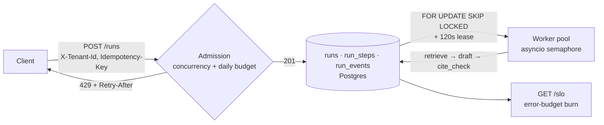

# Agent Runtime

**A Postgres-backed runtime for long-running, multi-step AI agent jobs: per-tenant admission control, lease-based worker claiming, resumable idempotent steps, SLO error budgets, and graceful drain on deploy.**

An agent that reviews a contract in a notebook is a demo. Serving that agent to many tenants means answering harder questions: what happens when a worker dies mid-run, when a client retries a submit, when one tenant floods the queue, or when a deploy lands in the middle of a three-minute job? This project is the runtime layer that answers them, using nothing more exotic than Postgres and `asyncio`.



## Key design decisions

- **Idempotent submits.** `UNIQUE (tenant_id, idempotency_key)` plus `ON CONFLICT DO NOTHING` means a retried submit maps to the existing run instead of creating a duplicate.
- **Admission at the door.** Before a run is accepted, the tenant's in-flight count and spend since midnight UTC are checked against `max_concurrent_runs` and `daily_cost_budget`. Rejections return `429` with `Retry-After: 30`.
- **Contention-free claiming.** Workers claim with `FOR UPDATE SKIP LOCKED`, so many workers can poll one table without blocking each other. A claim is a 120-second lease, renewed before every step; a run whose lease expires (its worker died) becomes claimable again.
- **Resume, don't repeat.** A run's plan is written once to `run_steps` with stable `step_key`s. On reclaim, steps already marked `done` are skipped, and each step's output and cost are written together so a crash can't record one without the other.
- **Retry only what can succeed.** Handlers raise `TransientError` (retried up to 4 times with exponential backoff capped at 30s) or `TerminalError` (never retried).
- **Backpressure via the queue.** A semaphore caps in-flight runs per worker (`MAX_CONCURRENCY`, default 8). When it's full the worker stops claiming, so overflow waits in Postgres rather than in process memory.
- **SLOs as error budgets.** `/slo` reports success rate (objective 99%) and the share of runs finishing within 180s (objective 95%), plus how much of each error budget is burned. It sets `page: true` when either burn exceeds 50%.
- **Graceful drain.** On `SIGTERM`/`SIGINT` the worker stops claiming and waits for in-flight runs; see [DEPLOY.md](DEPLOY.md) for how this interacts with leases and orchestrator grace periods.

## Quick start

Requires Python 3.10+ and PostgreSQL.

```bash
git clone https://github.com/AliAzamat/agent-runtime-production-platform.git
cd agent-runtime-production-platform
pip install fastapi uvicorn "psycopg[binary]" psycopg_pool

createdb agentrt
psql -d agentrt -f app/models/schema.sql
psql -d agentrt -c "INSERT INTO tenants (id) VALUES ('acme-legal');"

export DATABASE_URL=postgresql:///agentrt
```

The repository defines the API routers but no FastAPI application object yet. Until one is added, a minimal `main.py` at the repo root wires them up:

```python
from fastapi import FastAPI
from app.api.routes import runs, cancel, slo

app = FastAPI(title="Agent Runtime")
for module in (runs, cancel, slo):
    app.include_router(module.router)
```

Then, in two terminals:

```bash
uvicorn main:app --reload          # API
python -m app.worker.lifecycle     # worker (Ctrl-C drains gracefully)
```

Submit a run and check the SLO report:

```bash
curl -X POST localhost:8000/runs \
  -H "X-Tenant-Id: acme-legal" -H "Idempotency-Key: review-001" \
  -H "Content-Type: application/json" \
  -d '{"task_type": "contract_review", "input": {"doc": "nda.pdf"}}'
# {"run_id": "…", "created": true}

curl localhost:8000/slo
# {"window_runs": 1, "success_rate": 1.0, "latency_slo_rate": 1.0, ... "page": false}
```

This flow — submit, worker claims and executes all three `contract_review` steps, run marked `succeeded` with accumulated cost `0.062`, SLO report — was verified against PostgreSQL 16.

## API

| Method | Path | Description |
|---|---|---|
| `POST` | `/runs` | Submit a run. Headers: `X-Tenant-Id`, `Idempotency-Key`. Body: `{"task_type", "input"}`. Returns `201` (new) or `200` (existing), `429` if not admitted. |
| `POST` | `/runs/{run_id}/cancel` | Request cancellation. Queued runs are cancelled immediately; running runs get a cancel flag. `409` if finished or owned by another tenant. |
| `GET` | `/slo?window_hours=1` | Success and latency SLIs with error-budget burn and a `page` flag. |

## Configuration

| Variable | Default | Purpose |
|---|---|---|
| `DATABASE_URL` | `postgresql://localhost/agentrt` | Postgres connection string |
| `WORKER_ID` | `worker-1` | Identity recorded on claimed runs; must be unique per worker |
| `MAX_CONCURRENCY` | `8` | Max runs a worker executes at once |

## Project layout

```
app/
├── api/routes/       runs.py · cancel.py · slo.py
├── services/         admission.py        per-tenant concurrency + budget
├── repositories/     runs.py             idempotent submit, event log
├── worker/           claim.py            SKIP LOCKED claim + lease renewal
│                     executor.py         plan-once, skip-done, atomic step writes
│                     pool.py             semaphore-bounded claim loop
│                     lifecycle.py        signal handling + drain
│                     retry.py            transient vs. terminal errors
│                     cancellation.py     cooperative cancel helpers
├── agent/steps.py    task plans and step handlers
├── observability/    slo.py              SLIs and error-budget burn
├── db/postgres.py    psycopg connection pool
└── models/schema.sql tenants · runs · run_steps · run_events
```
